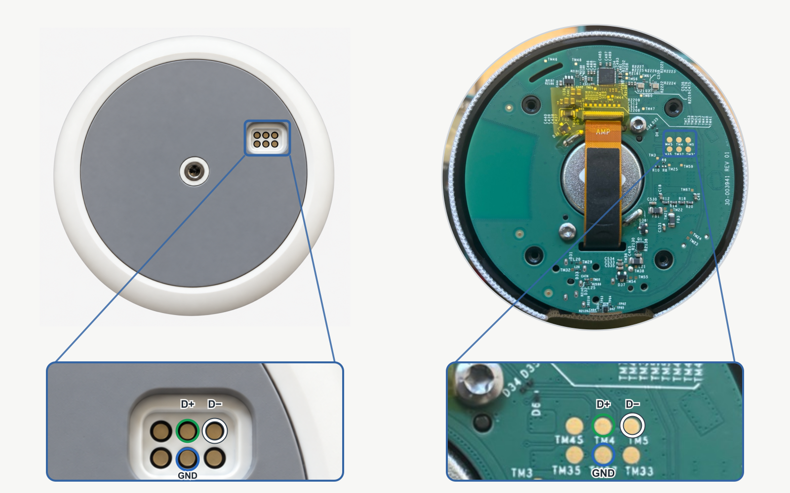

# Echo Plus 2 Root

Root the **Echo Plus (2nd generation), model L9D29R**. The full procedure was tested on `NS6575/8338N` (device software version `13323244164`, possibly shown with leading zeros in the Alexa app). Exact-image paths for `NS6536/2509N`, `NS6541/2965N` and `NS65741/8149N` are prepared for a first device test. The first stage uses [MTKClient](https://github.com/bkerler/mtkclient)'s Kamakiri or Kamakiri2 BootROM path to start a temporary recovery from RAM. The second installs an app that uses the Binder use-after-free bug **[CVE-2019-2215](https://projectzero.google/2019/11/bad-binder-android-in-wild-exploit.html)** to regain root after an ordinary cold boot. Amazon's signed kernel still boots. This does not install a custom ROM.

**Rooting and wiring can cause data loss or device damage. Proceed at your own risk.** The BootROM entry point is fixed in the chip, so a firmware update cannot remove it. If the device still reaches BootROM, stage 1 offers a way back to temporary root. This does not make the Echo unbrickable, and a factory reset cannot repair damaged firmware or hardware.

The guide has three parts: **get root once**, **keep root**, then optionally **use root** for a custom voice assistant. I directed this research with Codex (GPT-6 Sol), which wrote much of the device-specific code. The [write-up](https://blog.tripton.dev/rooting-an-echo-plus-2-with-ai/) tells that story and explains the exploits. A [short video](https://youtube.com/shorts/v-o031CwLJI) shows the finished voice assistant in use.

## Connect the Echo

To use the BootROM exploit, you need a USB data connection to the Echo. Check **Model No. L9D29R** on its underside first. The six contacts are accessible without opening the case. In the image, `TM4` is USB D+ (green USB wire), `TM5` is USB D− (white USB wire), and `TM37` is ground (blue wire). I soldered wires for a stable connection while investigating the device. Pogo pins can reach the same contacts from outside. Power the Echo with its own supply. Leave the USB red power wire disconnected.



Connect these contacts to your computer with USB data. Keep the Echo's power supply within reach for the BootROM steps below.

## Prepare the computer

I tested the full host workflow on macOS, and the `dump` and `boot` USB stages on Arch Linux ARM in a UTM VM. MTKClient implements Kamakiri and Kamakiri2 as separate BootROM exploit paths. The older Kamakiri USB request failed under Linux usbfs in my tests. Kamakiri2 uses different USB transfers and loaded the same Stage 1 payload. A native Linux x86-64 end-to-end run is still untested.

Install Python 3.11 or newer to run this guide, [uv](https://docs.astral.sh/uv/getting-started/installation/), Git, JDK (`javac` and `keytool`), `zip`, Android SDK Platform 36, Build Tools 36.0.0, NDK 28.2.13676358, Platform Tools, and LLVM Clang/LLD/llvm-objcopy **23.1.3**. Set `ANDROID_SDK_ROOT` if the SDK is outside its usual location.

Clone the repository and enter it:

```sh
git clone https://github.com/Tripton/echo-plus-2-root.git
cd echo-plus-2-root
```

Fetch the exact MTKClient revision. MTKClient uses a separate Python 3.14 environment, which `uv` creates inside the repository's ignored `local/` directory. `uv` downloads Python 3.14 if needed.

```sh
# 1. Download MTKClient and select the revision used for this project.
mkdir -p local/tools
git clone --filter=blob:none https://github.com/bkerler/mtkclient.git local/tools/mtkclient
git -C local/tools/mtkclient checkout 7cb40e727727dfe3faa065eefb29b16ed29bbdf1

# 2. Create MTKClient's environment and install its Python dependencies.
uv venv --python 3.14 local/tools/mtkclient/.venv
uv pip install --python local/tools/mtkclient/.venv/bin/python -r local/tools/mtkclient/requirements.txt

# 3. Verify the pinned tools. This does not access the Echo.
python3 echo_plus2.py check
```

If you already prepared MTKClient, run only `check`. The guide will store device dumps and build results under `local/` as well. Keep it when backing up the project: it will later contain signing keys.

## 1. Get temporary root

Connect USB data and disconnect the Echo's power. Then run:

```sh
python3 echo_plus2.py dump
```

Keep USB data connected. **Wait until the device search begins.** Then hold **Action** (the button marked with a dot) while supplying power to the Echo. Release it when BootROM is detected. You do not need to hold it during the long capture output.

The command reads the preloader, partition table, and active boot images needed for the next step from your Echo. It checks each image and builds the RAM image. This captures only the files needed for the guide, not a full eMMC backup. The command reads eMMC without changing it. It does **not** start Android or provide ADB yet.

The RAM stage reads the active A/B slot and matches its preloader, LK, and boot image to an exact firmware profile. The slot selects the partitions. The image contents select the patch offsets. `NS6536/2509N`, `NS6541/2965N` and `NS65741/8149N` pass offline build checks for either slot, but still need a device boot test. For one of these profiles, use `python3 echo_plus2.py boot --experimental-ram`. If the active slot changes after `dump`, run `dump` again before `boot`.

**If your firmware is not recognized:**

`dump` stops before building a RAM image and keeps the files it managed to read. To collect both boot slots for analysis, run:

```sh
python3 echo_plus2.py diagnose
```

Use the same power and Action-button sequence as for `dump`. `diagnose` saves a checked preloader in `local/device/diagnostic-*/`. If the hardware and partition checks pass, it also reads the LK and boot images from both slots. It only reads the device. These files can be used to work out firmware-specific offsets, but that takes manual reverse engineering. There is no RAM image for that firmware until a matching profile is added. If you get stuck, [open an issue](https://github.com/Tripton/echo-plus-2-root/issues) with your software version and I'll help investigate.

To start the temporary root with the prepared RAM image, disconnect power again, keep USB data connected, and run:

```sh
python3 echo_plus2.py boot
```
Again, wait until the device search begins, hold Action while reconnecting power, and release it after initial exploitation. You can inspect the temporary root ADB session now:

```sh
adb -d shell id
adb -d shell
```

Keep the Echo powered on for stage 2. This temporary access disappears at the next normal boot.

## 2. Keep root after a cold boot

**The tested path is `NS6575/8338N` in slot A.** For `NS6536/2509N`, `NS6541/2965N`, `NS65741/8149N`, or another slot, the installer and kernel targets pass offline checks but have not been run on a device. The installer reads that device's stock system files and checks its build identity, running kernel address, and USB script layout before writing `/data`. A successful experimental RAM boot is not proof of cold-boot root.

To keep root after a normal boot, you need to install the second stage app. It uses CVE-2019-2215 to regain root after a cold boot.
We use the temporary root session from the previous stage to install a signed app that runs at boot.
To install the app, run:
```sh
python3 echo_plus2.py persist
```

For another exact image or slot, use the same `persist` command after `boot --experimental-ram`. The installer checks the captured image, stock files, system fingerprint, and selected slot before installation. On later boots, the app checks the firmware fingerprint and, for the new profiles, the kernel version before attempting root. If a check fails, inspect the private captures before retrying. Do not substitute offsets from a nearby firmware build.

The first start after a factory reset can take several minutes. Wait for `INSTALL_READY_FOR_COLD_BOOT` before continuing. Keep a backup of `local/device/apk-signing.jks` and `local/device/apk-signing-password.txt`. This installation generates its own signing key; you need the same key to install a later app update without uninstalling it.

When the guide prints `INSTALL_READY_FOR_COLD_BOOT`, disconnect and reconnect the Echo's power **without holding any button** (i.e. normal cold boot). Leave USB data connected and verify the new boot:

```sh
python3 echo_plus2.py verify
```

`verify` checks the new boot's identity and root access, copies a root client to `/data/local/tmp/`, and prints `COLD_BOOT_ROOT_OBSERVED` only when those checks pass. The normal ADB shell has Android's `shell` identity. The copied root client lets you run a command with UID 0:

```sh
adb -d shell /data/local/tmp/lidar-root-client id
```

On my unit, root was available about 1.5 minutes after a software reboot. SELinux remains globally Permissive after the exploit. A firmware update can patch this kernel bug. Temporary root through BootROM (i.e. stage 1) remains available, but would need a physical connection and a new BootROM entry after each boot.

The original app allowed only one boot attempt. A stalled boot used it up and left the Echo offline. The app now tries once per boot for up to ten boots, resetting the counter after root succeeds. It cannot restart a hung device on its own.

## 3. Use root (optional)

Root is just the entry point for your own applications.
In my case I wanted a robust local voice assistant. The Echo's microphone and speaker are excellent, but Alexa is not required. The next section explains how to connect WiFi and optionally install Kiosk Satellite for a local voice assistant.

The guided WiFi gate and Kiosk setup below were tested only on `NS6575/8338N` in slot A. The other exact-image profiles are currently limited to the root stages above.

### Customize WiFi and Kiosk Satellite

The kernel bug is patchable, so an automatic update could remove cold-boot root. The Echo therefore starts with WiFi off. Once the installed app regains root, the helper installs IPv4 and IPv6 output filters and brings WiFi online. Local network traffic is allowed. You can also install Kiosk Satellite as a local voice assistant.

Edit the commented [config.example.toml](config.example.toml) to choose your WiFi network, Kiosk installation, authenticated WiFi ADB, and Amazon lockdown. Copy it to `local/config.toml` first. Nothing is applied until you run `configure`.

With the Echo connected over USB and `COLD_BOOT_ROOT_OBSERVED` confirmed, run:

```sh
cp config.example.toml local/config.toml
chmod 600 local/config.toml
nano local/config.toml
```

Check the config offline:

```sh
python3 echo_plus2.py configure --check
```

> **Read `amazon.lockdown` before applying the config.** Its default is `true` for a device dedicated to a local voice assistant. It removes Alexa Speech for user 0, disables the OTA and Alexa setup apps for user 0, and stops `update_engine`, `ahe`, and `amazonfiled` after root on each boot. Other Amazon packages remain on the system partition, while the gate blocks their ordinary WAN access. This intentionally breaks stock Alexa. To return through the supported steps in this guide, plan on a factory reset and a new Alexa setup. Set `amazon.lockdown = false` to retain the stock packages and services, though the WiFi gate still restricts their WAN access.

With USB connected and `COLD_BOOT_ROOT_OBSERVED` already confirmed, run:

```sh
python3 echo_plus2.py configure --config local/config.toml
```

This command first reboots normally to renew the short-lived local root session, then stages the WiFi profile while the Echo is offline. It applies your Kiosk and Amazon choices, checks that the boot budget, WiFi preference, and package changes are saved, and reboots again to verify the result.
When Kiosk is selected, the command starts it once and prints `KIOSK_SETUP_READY` with a browser address forwarded through USB. Keep USB connected for this initial setup. After a successful gated boot, open `http://<Echo-WiFi-IP>:2324/` from the same private WiFi subnet. Set a Kiosk admin password before using the page over WiFi.

When WiFi ADB is enabled, the command prints the reconnect and shell commands for this Echo's IP address. To inspect the current boot again, run `python3 echo_plus2.py gate-status` (add `--config` if needed). Enter Kiosk's Home Assistant account and voice settings on its setup page.

The setup command expects a clean, unconfigured WiFi profile and no earlier gate policy. If it stops after a partial step, keep USB connected and inspect the saved `local/device/` backup before retrying. Do not rerun `configure` blindly.

### Add a voice assistant (if Kiosk is installed)

Open the `http://127.0.0.1:...` address printed by `KIOSK_SETUP_READY` in a browser on the connected computer. Kiosk Satellite runs headless on the Plus 2, so the setup wizard is in that browser. Set an admin password, enter your Home Assistant address and a long-lived access token from **Home Assistant Profile → Security**, and enable Voice Satellite with your preferred wake word and voice pipeline. In Kiosk's **Settings → ESPHome**, enable ESPHome and set its API port to **23240** for this stock firmware. Add the discovered device in **Home Assistant → Settings → Devices & services** using the encryption key Kiosk shows. The [Kiosk headless guide](https://github.com/jxlarrea/kiosk-satellite/blob/main/docs/echo-dot.md) explains the same browser workflow.

Before completing Kiosk's wizard, its boot receiver may leave the app idle. Finish the setup before relying on it as a voice satellite after a restart.

If `configure` stopped after `GATE_STAGE_READY`, do not rerun it on the partly configured device. Check the gate with `python3 echo_plus2.py gate-status --config local/config.toml` while the current boot's short Root window is open (use your own config path if different). If that window has closed, the status command cannot confirm Root again until the next ordinary boot. Kiosk's setup page can still be opened without Root:

```sh
python3 echo_plus2.py kiosk-setup
```

This checks the USB identity, grants Kiosk's microphone permission, starts the installed app, and prints a local browser address. It does not change the WiFi gate or reboot the Echo.

When `kiosk.install = true`, `configure` also installs two fixed-purpose workers. One restores the installed Kiosk package's microphone permission if Android revokes it. The other reads Action and Mute from the Plus 2's input devices and sends those events only to a local Kiosk plugin. The workers are checked against hashes embedded in the root helper and start after root on each boot. Kiosk itself is not pinned to an APK version or archive hash.

Build and install the [ASR microphone plugin](integrations/asr-mic/README.md) first if you want the native beam direction. It selects the stock source-6 audio path for Kiosk's recorder and verifies that source after reopening the microphone. Then install the [Voice LED plugin](integrations/voice-led/README.md) for listening, mute, volume and beam-direction light patterns, and the [Buttons plugin](integrations/buttons/README.md) for Action and Mute. The optional [Temperature plugin](integrations/temperature/README.md) publishes the stock ambient-temperature estimate to Kiosk and Home Assistant. Install each ZIP in Kiosk's **Settings → Plugin Manager → Developer Tools → Install from ZIP** and enable it there. The installer places the device-side button worker, but the buttons only affect Kiosk after you enable the plugin.

Kiosk may still warn that its **Hardware buttons** accessibility service is missing. The Echo Buttons plugin uses the separate root button bridge instead. If Action and Mute work through that plugin, leave the accessibility service off to avoid duplicate key events. The installer grants Kiosk's microphone permission. For other optional features, check Kiosk's **Device → Permissions Manager** and grant only the permissions those features need.

### Optional: update Kiosk Satellite without a screen

This is only needed if you want to update Kiosk Satellite from its web interface. It is not part of the root or voice setup. On the Plus 2's Android 7.1.2, Kiosk normally needs an on-device confirmation to install an update. Its [optional update helper](https://github.com/jxlarrea/kiosk-satellite/blob/main/docs/updates.md#optional-update-helper) removes that prompt. With authenticated WiFi ADB connected, replace `192.168.1.42` below with the Echo's current IP address:

```sh
adb connect 192.168.1.42:5555
adb -s 192.168.1.42:5555 shell 'content read --uri content://me.jxl.kiosk_satellite.update-helper/start | sh'
```

Wait for `Kiosk Satellite update helper started`, then check **Device → Optional update helper** in Kiosk's web interface. It should report **Ready**. Use Kiosk's own **Install** button for the available release. Kiosk downloads the APK and performs the update. On the tested Plus 2, this updated Kiosk Satellite from 2026.11.5 to 2026.11.7 without a physical confirmation. The existing Home Assistant connection and Echo plugins were still present afterward, and the voice assistant answered again.

The helper survives a Kiosk app restart and self-update, but stops when the Echo reboots. Run the second command again before the next app update after a device reboot.

## Project layout

| Path | Role |
| --- | --- |
| `echo_plus2.py`, `configure_gate.py` | Guided root and optional WiFi gate commands |
| `config.example.toml` | Private WiFi, Kiosk APK, and network ADB settings template |
| `src/bootstrap/` | Firmware capture and temporary RAM root |
| `src/bootstrap/stock-transition/` | Return to signed Android and app installation |
| `src/persistence/` | Binder exploit app and root helper |
| `integrations/` | Optional Kiosk Satellite plugins for microphone, LEDs, buttons and temperature |

MTKClient credits xyzz for Kamakiri. Maddie Stone and Jann Horn analyzed the Binder bug in [Google Project Zero's write-up](https://projectzero.google/2019/11/bad-binder-android-in-wild-exploit.html). Project-authored source is licensed under [Apache-2.0](LICENSE).

See the [changelog](CHANGELOG.md) for tested integration updates.
